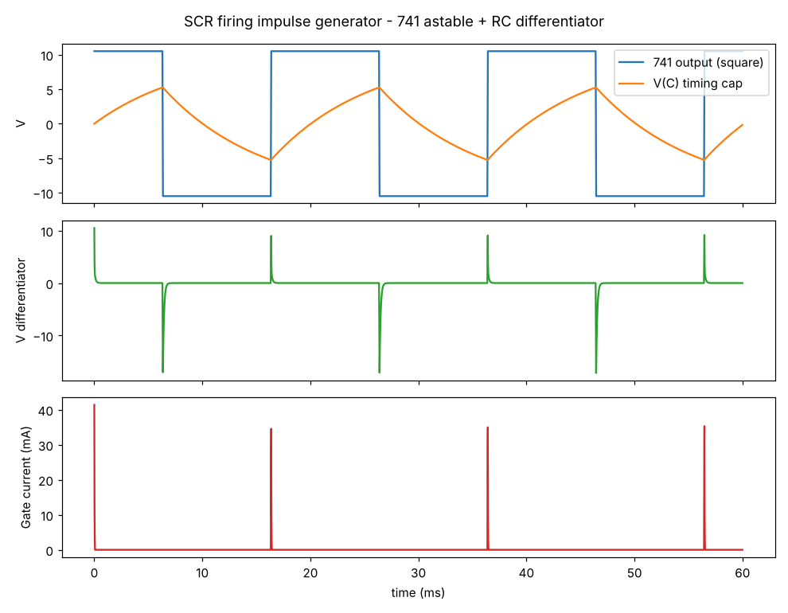

# توليد Impulse لـ Firing الـ SCR باستخدام Op-Amp 741 (Proteus)

## فكرة الدايرة
1. **741 Astable multivibrator** ← يطلع موجة مربعة (Square wave) ±10.5V بتردد 50Hz.
2. **RC Differentiator** (Cd + Rd) ← يحوّل كل حافة في المربعة لـ spike (impulse) حاد.
3. **Diode D1** ← يعدّي النبضات الموجبة بس للـ Gate (والـ D2 يقص السالبة).
4. **R_G** ← يحدد تيار الـ Gate.

```
              R1=10k
   +--------/\/\/\-------+
   |                     |
   |  R2=10k   |\        |
GND+--/\/\/\---|+ \      |
               |   >-----+------||------+----|>|----/\/\/\----> Gate (SCR)
          +----|- /  Vout     Cd=0.1u   |    D1     R_G=220
          |    |/  741                  |   1N4148
          |                            Rd=1k   D2 (anode GND, cathode node X)
          +---/\/\/\----+ (Vout)        |
          |   R=91k                    GND
         === C=0.1u
          |
         GND
   741: pin7 = +12V , pin4 = -12V , pin2 = (-) , pin3 = (+) , pin6 = Out
```

## المعادلات
- β = R2/(R1+R2) = 0.5
- T = 2·R·C·ln((1+β)/(1−β)) = 2 × 91k × 0.1µ × ln3 ≈ **20 ms ⇒ f ≈ 50 Hz**
- ثابت زمن الـ differentiator: τ = Rd·Cd = 100µs ≪ T/2 ⇒ نبضة ضيقة (عرضها ~70µs عند Ig>5mA) كفاية لتشغيل الـ SCR.
- تيار الـ Gate peak ≈ (10.5 − 0.7 − 0.7)/220 ≈ **40 mA** (أكبر من I_GT لمعظم الـ SCRs).

## قايمة المكونات في Proteus (Pick Devices)
| المكون | الاسم في Proteus | القيمة |
|---|---|---|
| Op-Amp | `741` (أو `UA741`) | — |
| مقاومات | `RES` | R1=10k, R2=10k, R=91k, Rd=1k, R_G=220 |
| مكثفات | `CAP` | C=0.1µF, Cd=0.1µF |
| دايودات | `1N4148` | D1, D2 |
| مصادر | DC Generator أو `BATTERY` | +12V و −12V |
| SCR (اختياري للتجربة) | `2N5060` أو `SCR` | — |
| حمل (اختياري) | `LAMP` أو `RES` + مصدر AC `ALTERNATOR` | — |
| قياس | Virtual Instruments → `OSCILLOSCOPE` | — |

## خطوات الرسم والتشغيل
1. حط الـ 741، وصّل pin7 بـ +12V و pin4 بـ −12V.
2. R1 من الـ Out (pin6) لـ pin3، و R2 من pin3 للأرضي (positive feedback ⇒ Schmitt trigger).
3. R=91k من الـ Out لـ pin2، و C=0.1µF من pin2 للأرضي.
4. Cd من الـ Out لنقطة X، و Rd من X للأرضي، و D2 (anode للأرضي، cathode على X).
5. D1 (anode على X) ← R_G ← Gate الـ SCR، والـ Cathode بتاع الـ SCR على الأرضي.
6. وصّل الأوسيلوسكوب: **A** = Out الـ 741، **B** = مكثف C، **C** = نقطة X، **D** = الـ Gate.
7. اضغط Play، وظبّط الأوسيلوسكوب على ~5ms/div و 5V/div ← هتشوف المربعة والـ impulses.

> لتغيير التردد غيّر R أو C. ولو عايز Impulse متزامن مع الـ AC (للتحكم في زاوية الإشعال α)، استبدل الـ astable بـ 741 zero-crossing comparator على عينة من جهد الـ AC + differentiator بنفس الشكل.

## التحقق بالمحاكاة
`simulate.py` بيعمل محاكاة رقمية بسيطة (741 بـ slew rate 0.5V/µs وتشبّع ±10.5V):



النتيجة: T = 19.99ms (50Hz)، و peak gate current ≈ 35–40mA. (النبضة الأولى عند t=0 بسبب بداية التشغيل.)

## الفيديو
`scr_impulse_741.mp4` (اتعمل بـ `video.py` و `schem.py`): المخطط والموجات الأربعة شغالة زي الأوسيلوسكوب، وتكبير لنبضة واحدة.
الموجات دي من محاكاة Python، مش من Proteus.
